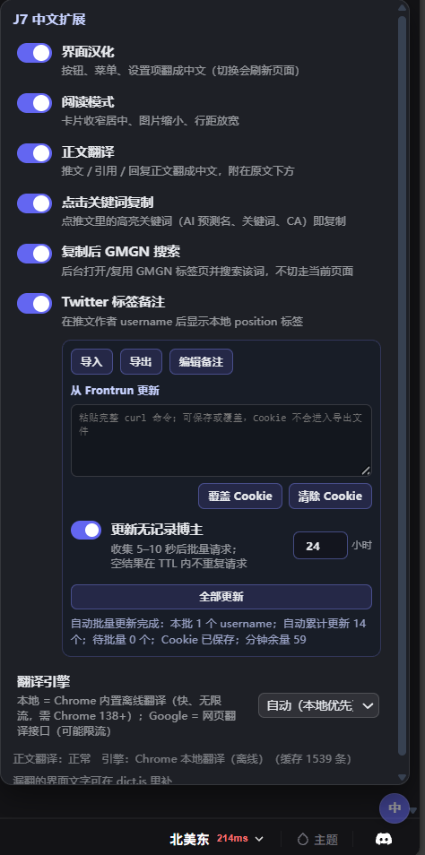
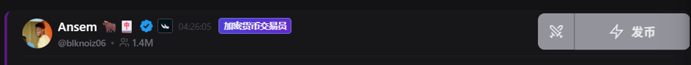
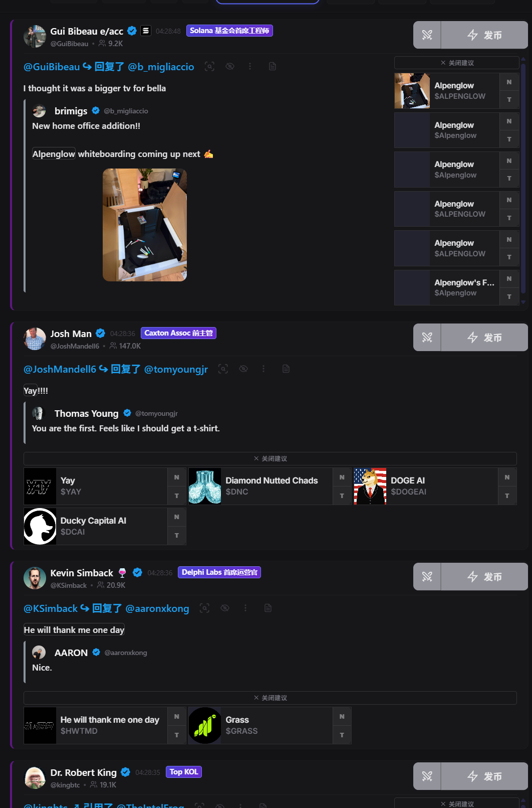

# J7Tracker 中文界面

> 让 [j7tracker.io](https://j7tracker.io/@howe) 好读的 Chrome 扩展：界面汉化 + 阅读模式 + 推文正文自动翻译 + Twitter 作者标签。

J7Tracker 是一个实时社媒追踪器，但界面全英文、卡片巨宽、信息密度低。这个扩展把它改造成一个舒服的中文阅读器，各项功能都在页面右下角「中」按钮的菜单里独立开关，默认全开：

| 功能 | 说明 |
| --- | --- |
| **界面汉化** | 900+ 条界面文案（按钮、菜单、设置、弹窗、提示）翻成中文；推文头部动词本地化（`@xxx 发布了 / 回复了 / 转发了 / 引用了 / 关注了`）；时间统一转 24 小时制。**不动**推文正文、币名代码、账号名、简介等用户内容 |
| **阅读模式** | 卡片收窄到 920px 居中、图片缩小、行距放宽、次要按钮 hover 才显示、高亮药丸改细下划线 |
| **点击关键词复制** | 站点会把关键词（AI 预测名、你设置的关键词、CA 等）标成高亮药丸——点一下即复制该词到剪贴板，弹「已复制」气泡；悬停有描边提示。站点原生没有这个能力（药丸默认 `pointer-events: none`，本扩展恢复了它的可点性） |
| **复制后 GMGN 搜索** | 点关键词后在**后台**打开/复用 GMGN（gmgn.ai）标签页并在其搜索弹窗填入该词——不切走焦点，人留在 j7 继续看流，想看结果自己切过去（配合浏览器分屏体验最佳）。始终复用同一个标签页，不会越开越多。GMGN 首次打开搜索弹窗要求可信事件，本扩展通过直接调用其 React `onFocus` 处理函数绕过（`gmgn.js` 以 MAIN world 注入）；后台打开由 service worker 的 `tabs` API 完成（因此声明了 `tabs` 权限）。已有 GMGN 页时**不做任何导航**——background 经 `gmgn-bridge.js` 直接发消息给页面原地换搜索词，零刷新 |
| **正文翻译** | 推文 / 引用 / 回复 / 资料简介自动翻成中文，以「译」块附在原文下方。默认走 **Chrome 内置离线翻译**（Translator API，快、无限流、不出网），Google 网页接口兜底；带本地缓存，刷新不重翻 |
| **Twitter 标签备注** | 按 username 在作者时间后显示备注。内置 1493 个 Frontrun 日常使用记录，支持卡片快捷编辑、集中增删改查、JSON 导入/导出、缺失账号自动补全和全部更新 |

## 安装

1. 下载本仓库（Code → Download ZIP 并解压，或 `git clone`）
2. Chrome 打开 `chrome://extensions`，右上角开启「开发者模式」
3. 点「加载已解压的扩展程序」，选择本文件夹
4. 打开 / 刷新 [j7tracker.io](https://j7tracker.io/@howe) 即可

> 还没有 J7Tracker 账号？从 [j7tracker.io/@howe](https://j7tracker.io/@howe) 进入并按提示加入 Discord 领取登录凭证。

> 要求 Chrome 内置离线翻译可用需 **Chrome 138+**（更低版本自动退回 Google 接口）。首次翻译某个语种时 Chrome 会静默下载几 MB 的语言包，个别版本要求先在页面上点击一下才允许下载，点一下即可。

## 使用

- 右下角紫色圆点「中」→ 打开菜单：功能开关、Twitter 标签管理和翻译引擎选择（自动 / 仅本地 / 仅 Google）。
- 「界面汉化」切换会刷新页面；另外两项即时生效。
- 设置存在 j7tracker.io 的 localStorage：`j7zh_enabled` / `j7zh_reader` / `j7zh_autotrans` / `j7zh_copykw` / `j7zh_gmgn` / `j7zh_labels` / `j7zh_engine`，译文缓存在 `j7zh_trcache_v1`（约 1500 条滚动）。

### Twitter 标签

当前内置备注数据库来自 **Frontrun 的日常使用记录**，不属于 J7Tracker 官方数据。每条 JSON 记录都带来源字段：`FRONTRUN` 表示 Frontrun 数据，`USER` 表示用户本地新增或修改。用户备注优先显示，后续 Frontrun 更新不会覆盖；点击「恢复 Frontrun」可回到原备注。







1. 打开「Twitter 标签备注」即可使用内置数据；只有非空 `position` 会显示标签。鼠标进入推文卡片时，作者时间/标签旁会显示铅笔 `✎`；点击后打开自适应居中的大号编辑框，拖动标题栏可调整位置。移出卡片后铅笔自动隐藏。
2. 菜单中的「编辑备注」提供集中管理：搜索、新增、修改、删除（隐藏）和恢复 Frontrun 备注。
3. 「导入」接受 JSON 数组，或含 `data` / `rows` / `labels` 数组的对象；每条记录使用 `twitterUsername`、`position` 和 `source`。同名账号不区分大小写；用户备注优先于导入的 Frontrun 备注，其余同来源记录覆盖同名并保留其他记录。
4. 「导出」保存当前全部标签及来源，但不会包含 Cookie 或 Frontrun 请求配置。
5. 如需联网更新，从 DevTools 复制 Frontrun `batch-query-light` 请求的完整 cURL。首次点「保存 Cookie」，以后可粘贴新 cURL 点「覆盖 Cookie」，也可点「清除 Cookie」同时移除本地配置和该配置写入的目标域 Cookie。输入框保存后会清空。
6. 「更新无记录博主」会先在页面本地收集 username，从发现第一条开始随机等待 5–10 秒，再合并成批量请求（同名去重、每批最多 20 个），不会按每条推文单独请求。面板会显示待批量数量和自动累计更新数量。
7. Frontrun 也没有备注时会记录本次查询时间，在可配置的空结果 TTL 内不再重复请求（默认 24 小时，范围 1–8760 小时）；TTL 到期且再次刷到该账号时才重新查询。只有响应头明确报告分钟余量为 `0` 或返回 429 时才按限流窗口暂停；缺少限流响应头会显示为未知，不再误报为 `0`。真正的 500 服务器错误会显示服务端信息并冷却 5 分钟，避免循环请求。
8. 「全部更新」按每批最多 20 个、串行随机间隔刷新当前全部账号。面板会显示进度和接口剩余额度。

由于 Frontrun 会对非原版扩展的 `Origin` 返回 500，本扩展使用一条静态网络规则，仅在请求上述完整 API 地址时移除 `Origin`。规则不会匹配其他 Frontrun 路径、J7Tracker、Twitter 或翻译请求。

数据示例：

```json
{"twitterUsername":"kieranwarwick","position":"Illuvium联创","source":"FRONTRUN"}
{"twitterUsername":"example_user","position":"我自己添加的备注","source":"USER","frontrunPosition":"原 Frontrun 备注"}
```

删除 Frontrun 备注时会保存为 `source: "USER"` 和 `hidden: true`，所以刷新或全部更新后不会自动重新出现。自定义备注保存在当前浏览器的 `chrome.storage.local` 中。

Frontrun 空结果会额外保存 `frontrunCheckedAt`（毫秒时间戳），用于计算上述 TTL；这不会改变备注的 `source`。

Frontrun Cookie 只保存在 `chrome.storage.local` 和目标域 Cookie 存储中，不会进入标签 JSON 或导出文件。Cookie 失效后可覆盖为新的 cURL，也可随时清除。

## 翻译引擎

| 引擎 | 原理 | 特点 |
| --- | --- | --- |
| 本地（默认优先） | Chrome 内置 Translator API + LanguageDetector，先检测语种再翻译，按段落保留换行 | ~10ms/条，离线，无限流，文本不出本机 |
| Google 兜底 | background service worker 调 `clients5` 批量接口（一批 10 条），失败回退 `gtx` 单条 | 串行 + 最小间隔 + 429 指数退避（5s→5min），带缓存；**会把推文文本发给 Google** |

本地引擎创建失败（如语言包下载中）按临时失败处理，60 秒后自动重试；需要用户手势的下载会在下一次点击页面时自动补上。

## 隐私

- 界面汉化、阅读模式：纯本地，不发任何请求。
- 正文翻译用本地引擎时：不出网。仅当本地不可用 / 语种不支持 / 手动选了 Google 时，推文文本（公开内容，不含你的账号信息）会发给 Google 翻译接口。
- Twitter 标签和用户自定义备注默认只读本地数据。只有用户保存 Frontrun cURL 并主动开启自动补全或点击全部更新时，扩展才向 `loadbalance.frontrun.pro` 发送公开的 Twitter username。
- `host_permissions` 声明两个 Google 翻译域名和 Frontrun 标签接口；`gmgn.js` 只在带 `#j7q=` 标记时动作。扩展不收集、不上报其他数据。

## 文件说明

| 文件 | 作用 |
| --- | --- |
| `manifest.json` | MV3 清单，只在 `*.j7tracker.io` 运行 |
| `label-utils.js` | username、导入数据、cURL/Cookie 和批次的纯逻辑解析，供 content 与 background 共用 |
| `twitter-labels.seed.json` | 内置的 1493 个 `twitterUsername` / `position` / `source: FRONTRUN` 初始记录 |
| `rules/frontrun-origin.json` | 仅对 Frontrun 标签 API 移除扩展 `Origin` 的静态网络规则 |
| `dict.js` | 英→中字典：`exact` 精确匹配、`regex` 带数字/变量的模式（含 12→24 小时制转换）、`context` 推文头部动词、`inButton` 按钮内特殊译法 |
| `content.js` | 界面汉化引擎、正文翻译调度、作者标签注入和右下角菜单 |
| `background.js` | service worker：代发 Google 翻译请求；持久化标签与 Frontrun 配置；串行批量更新、退避和进度广播 |
| `gmgn.js` | 注入 gmgn.ai（MAIN world）：自动打开搜索弹窗并填入关键词；入口有三个——首载 `#j7q=`、hashchange（兜底）、bridge 消息（常规，零导航） |
| `gmgn-bridge.js` | 注入 gmgn.ai（isolated world）的消息桥：把 background 的搜索指令 postMessage 给 MAIN world 的 `gmgn.js` |
| `style.css` | 阅读模式、译文块、菜单样式；以及让中文按钮按整词排版（CJK 会被 flex 拆成单字竖排）的 `word-break: keep-all` |

## 自己补翻译

页面遇到没翻的英文：

1. 打开 `dict.js`，在 `exact` 里加一行 `"English text": "中文",`（key 与页面文字精确一致；首尾空白忽略、连续空白按一个空格算）
2. 带数字的文案（如 `Showing 50 of 7053`）加到 `regex`；同一个词在按钮里要不同译法加到 `inButton`
3. `chrome://extensions` 点扩展卡片上的刷新 ↻，再刷新页面

调试：控制台 `__j7zh.lookup("Some text", document.body)` 查某句会翻成什么；`__j7zh.walk(document.body)` 手动补扫界面；`__j7zh.scan()` 重扫正文翻译；`__j7zh.scanLabels()` 重扫作者标签；`__j7zh.tr` / `__j7zh.labels` 查看运行状态。

## 已知边界

- 字典覆盖主界面、全部设置面板、发币/复刻/自动化/费用/历史/布局/节点/主题等弹窗；站点日后新增文案需补字典。
- 自动化（Automations）面板被站方 Beta 门槛遮罩，遮罩下的表单只翻了可见部分。
- 平台名（Pump、Bonk、Bags、Axiom、GMGN…）和音效名（Ding、Chime…）有意保留英文。
- 推文里币圈黑话（gm、ngl、cooked…）机器翻译效果一般，两个引擎都一样。
